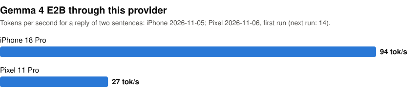

# ai-sdk-litert-lm

Run LLMs on-device from the [Vercel AI SDK](https://ai-sdk.dev): `generateText` and `streamText` on iPhones, on Android phones and in the browser, with no server. On 2026-11-05, Gemma 4 E2B streamed a two-sentence reply at 94 tokens per second on an iPhone 18 Pro. This package is a provider for [LiteRT-LM](https://developers.google.com/edge/litert-lm), Google's runtime for on-device LLMs.

<p align="center">
<picture>
  <source media="(prefers-color-scheme: dark)" srcset="https://raw.githubusercontent.com/john-rocky/ai-sdk-litert-lm/main/docs/images/speed-dark.svg">
  
</picture>
</p>

```ts
import { streamText } from 'ai'
import { litertlm } from 'ai-sdk-litert-lm'

const result = streamText({
  model: litertlm('hf://litert-community/gemma-4-E2B-it-litert-lm'),
  prompt: 'What can you do without a network connection?',
})

for await (const text of result.textStream) console.log(text)
```

The first call downloads the model from Hugging Face, 2 to 3 GB, and keeps it for later calls. On an iPhone, `react-native-litert-lm` asks for an entitlement for a model this size, and that needs a paid Apple Developer account ([Install](#install)). [Tools and structured output](docs/usage.md) work too. In the browser, a reasoning model's thoughts reach your code. On a phone, only thoughts the model writes at the start of its text, in `<think>` or `<thinking>` tags, do.

On a phone the provider runs on [`react-native-litert-lm`](https://github.com/hung-yueh/react-native-litert-lm). In a browser it runs on Google's [`@litert-lm/core`](https://www.npmjs.com/package/@litert-lm/core) with WebGPU. Your bundler picks the right one, so one Expo app can target iPhone, Android and the web with the same AI code.

## Install

### Expo (iOS, Android, web)

```bash
npx expo install ai-sdk-litert-lm ai react-native-litert-lm \
  react-native-nitro-modules @ungap/structured-clone \
  @stardazed/streams-text-encoding
# For the web target:
npx expo install @litert-lm/core react-dom react-native-web
```

Keep the React Native version your Expo release expects. With 0.88.0 instead of Expo's 0.88.1, my iOS build crashed on launch.

Add the plugin to `app.json`:

```json
{
  "expo": {
    "plugins": [
      [
        "react-native-litert-lm",
        { "ios": { "extendedVirtualAddressing": true, "increasedMemoryLimit": true } }
      ]
    ]
  }
}
```

The two iOS settings let an app load models of about 2 GB or more, such as Gemma 4 E2B. They need a paid Apple Developer account. For a smaller model, `"plugins": ["react-native-litert-lm"]` is enough.

The AI SDK needs a few web APIs that React Native doesn't have. Copy [`example/polyfills.js`](example/polyfills.js) into your app and import it first:

```ts
import './polyfills'
```

Then build a native app. Expo Go can't load native modules:

```bash
npx expo prebuild
npx expo run:android --variant release
```

For iOS, build the Xcode project that `npx expo prebuild` generates.

### Bare React Native

Install `ai-sdk-litert-lm`, `ai`, `react-native-litert-lm` and `react-native-nitro-modules`, then follow the [polyfill guide](https://www.react-native-ai.dev/docs/polyfills) for bare apps, which also adds web streams. For a web build, use the Browser only install below.

### Browser only

```bash
npm install ai-sdk-litert-lm ai @litert-lm/core
```

## Try the example

[`example/`](example) is one Expo app for all three targets. It has a small chat and a button that runs this package's checks with a real model on your device. On 2026-11-05 and 2026-11-06 I ran them on a Pixel 11 Pro, on an iPhone 18 Pro and in Chrome 156, and they all passed.

```bash
git clone https://github.com/john-rocky/ai-sdk-litert-lm
cd ai-sdk-litert-lm
npm install
npm pack   # the example installs this package from the tarball
cd example
npm install

npx expo start --web                      # Browser
npx expo run:android --variant release    # Android
```

For iOS, run `npx expo prebuild -p ios --clean`, set a bundle id your team can sign in the Xcode project it generates, and build that project, which is how I built it. The test results appear on the screen.

## Documentation

- [Choose a model](docs/choose-a-model.md): model ids, which file each platform gets, and where to find models
- [Usage](docs/usage.md): preloading, tools, structured output, reasoning, long conversations, per-call options and errors
- [Test results](docs/what-was-checked.md)

## Development

```bash
npm install
npm test
npm run typecheck
```

## License

MIT. Independent project, not affiliated with Google or Vercel.
